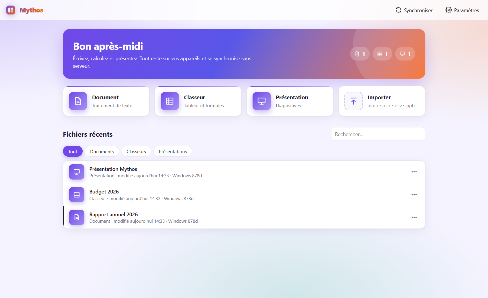
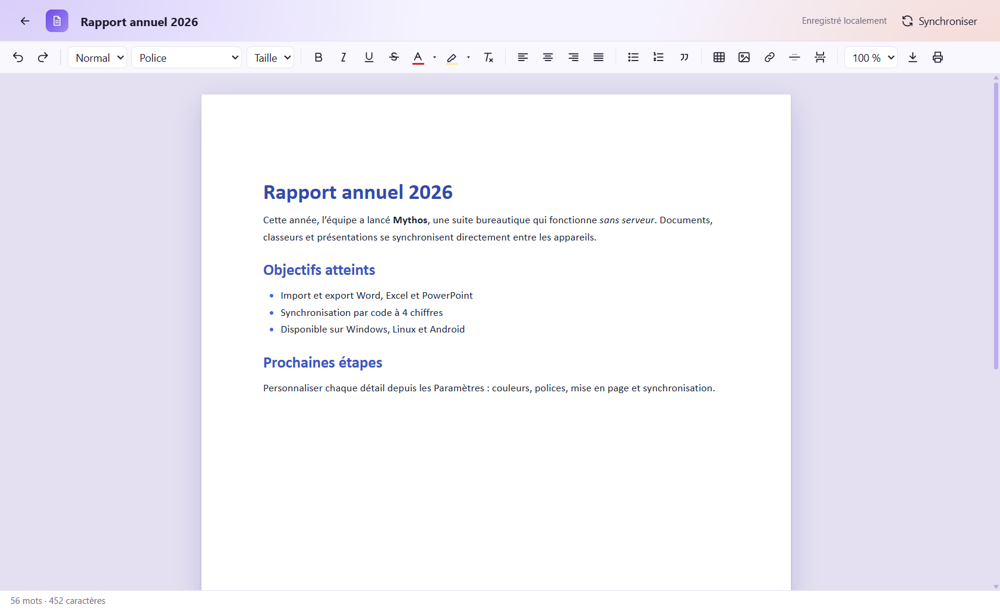
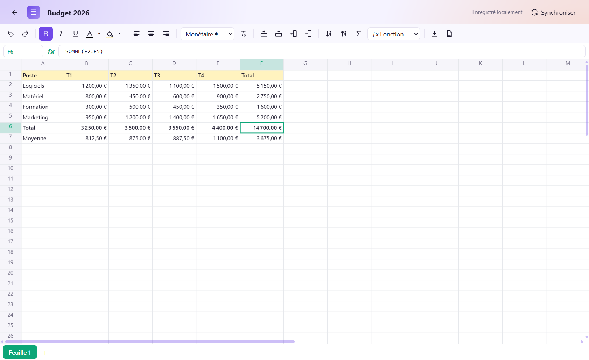
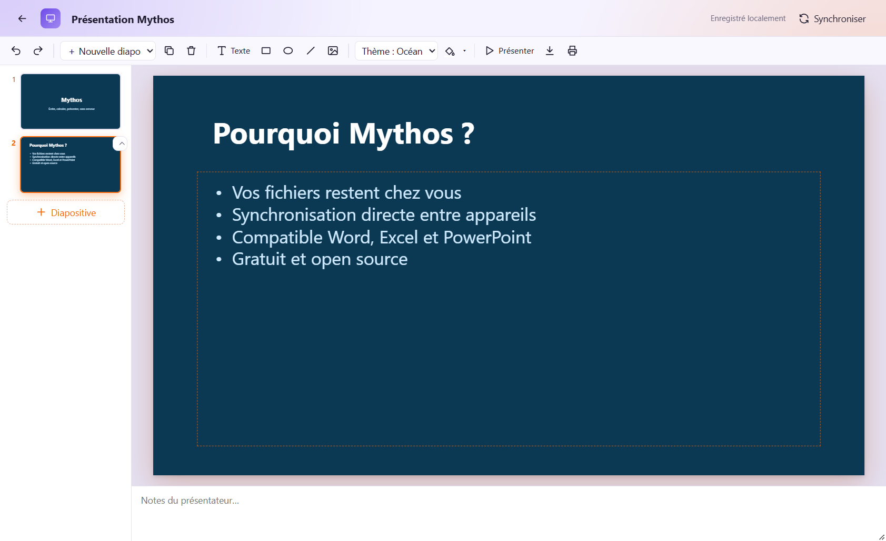
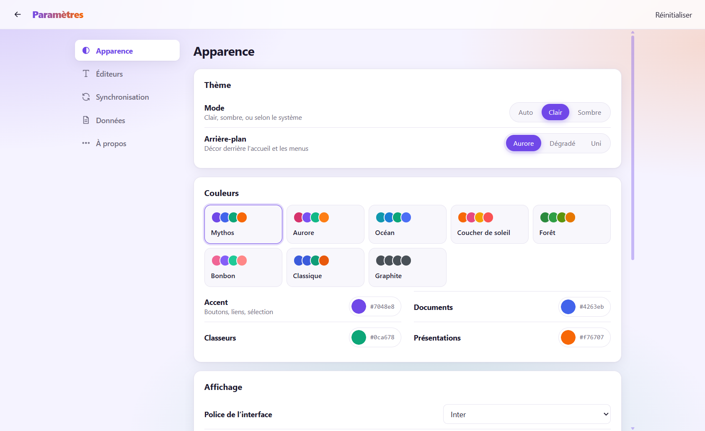
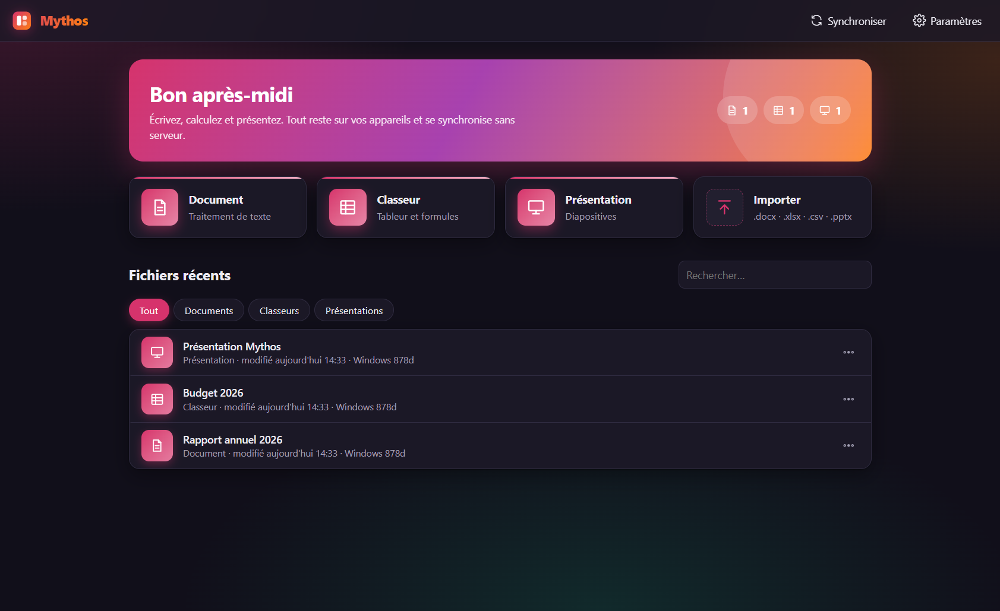

<div align="center">

[English](README_en.md) · [简体中文](README_zh.md) · [繁體中文](README_zh-TW.md) · [日本語](README_ja.md) · [한국어](README_ko.md) · [Türkçe](README_tr.md) · [Русский](README_ru.md) · [Tiếng Việt](README_vi.md) · **ไทย** · [Deutsch](README_de.md) · [Español](README_es.md) · [Français](../../README.md) · [Українська](README_uk.md) · [Polski](README_pl.md) · [Português (Brasil)](README_pt-BR.md) · [العربية](README_ar.md) · [فارسی](README_fa.md) · [Bahasa Indonesia](README_id.md) · [Italiano](README_it.md)
· [Ελληνικά](README_el.md) · [മലയാളം](README_ml.md) · [Roman Urdu](README_ur-Latn.md) · [Română](README_ro.md)

</div>

# Mythos — ชุดโปรแกรมสำนักงานแบบออฟไลน์ ซิงค์ได้โดยไม่ต้องมีเซิร์ฟเวอร์



| เอกสาร | สเปรดชีต | งานนำเสนอ |
|---|---|---|
|  |  |  |

| การตั้งค่า | โหมดมืด |
|---|---|
|  |  |

**ซิงค์ด้วยรหัส 4 หลัก**: บนอุปกรณ์หนึ่ง เลือก *ซิงค์ → แสดงรหัส* บนอีกเครื่อง เลือก *ป้อนรหัส* รหัสนี้ใช้เพียงเพื่อให้ทั้งสองเครื่องหากันเจอบนรีเลย์ (ntfy.sh เปลี่ยนได้ในการตั้งค่า) และคำเชิญบนรีเลย์ถูกเข้ารหัสไว้ จากนั้นเอกสารของคุณจะส่งตรงจากอุปกรณ์หนึ่งไปยังอีกอุปกรณ์หนึ่ง

โปรแกรมประมวลผลคำ สเปรดชีต และงานนำเสนอ รวมอยู่ในแอปเดียว สำหรับ **Windows, Linux และ Android**
ไฟล์อยู่บนอุปกรณ์ของคุณ การซิงค์ทำโดยตรงระหว่างอุปกรณ์

## การติดตั้ง

| ระบบ | ไฟล์ | ตำแหน่ง |
|---|---|---|
| Windows | `Mythos-Setup-1.1.0.exe` (ตัวติดตั้ง) หรือ `Mythos-Portable-1.1.0.exe` | `release/` |
| Linux | `Mythos-1.1.0-x64.tar.gz` (แตกไฟล์แล้วรัน `./mythos`); AppImage คอมไพล์บน Linux ด้วย `npm run dist:linux` | `release/` |
| Android | `app-debug.apk` | `android/app/build/outputs/apk/debug/` |

ไฟล์ไม่ได้ลงนาม: Windows SmartScreen จะให้เลือก "ข้อมูลเพิ่มเติม → เรียกใช้ต่อไป"
และ Android จะขอให้อนุญาตการติดตั้งแอปจากแหล่งที่ไม่รู้จัก

## คอมไพล์ใหม่

```sh
npm install
npm run dev          # เวอร์ชันเบราว์เซอร์สำหรับพัฒนา (http://localhost:5173)
npm start            # แอปเดสก์ท็อป
npm run dist:win     # ตัวติดตั้ง Windows → release/
npm run dist:linux   # AppImage + tar.gz → release/ (ควรรันบน Linux)
npm run android      # คัดลอกเว็บไซต์ไปที่ android/ แล้ว:
cd android && gradlew assembleDebug   # JAVA_HOME = JDK 21
```

## การซิงค์โดยไม่ต้องมีเซิร์ฟเวอร์

เอกสารแต่ละฉบับเป็น **Yjs CRDT** ที่จัดเก็บใน IndexedDB อุปกรณ์สองเครื่องที่แก้ไขเอกสารเดียวกันขณะออฟไลน์
จะรวมการเปลี่ยนแปลงเข้าด้วยกันโดยอัตโนมัติ ไม่มีความขัดแย้ง และไม่ใช่แบบ "เวอร์ชันสุดท้ายชนะ"

สามวิธีในการเชื่อมอุปกรณ์ (แผง **ซิงค์**):

1. **จับคู่โดยตรง (WebRTC)**: อุปกรณ์ A แสดง QR code คำเชิญ B สแกน (หรือวางรหัส)
   แล้วแสดง QR code ตอบกลับให้ A สแกนอีกที จากนั้นการเชื่อมต่อจะเข้ารหัสตั้งแต่ต้นทางถึงปลายทาง (DTLS)
   แบบเรียลไทม์ บน Wi-Fi ภายในจะไม่ใช้เซิร์ฟเวอร์ใดเลย ตัวเลือก "ผ่านอินเทอร์เน็ต" ใช้เซิร์ฟเวอร์ STUN สาธารณะ
   เพียงเพื่อค้นหาที่อยู่สาธารณะ (ไม่มีข้อมูลใดผ่านเซิร์ฟเวอร์นั้น) ต้องทำใหม่ทุกครั้งที่เปิดแอป
2. **โฟลเดอร์ที่ใช้ร่วมกัน** (Windows / Linux): เลือกโฟลเดอร์ที่ซิงค์ด้วย Syncthing, แฟลชไดรฟ์ USB หรือโฟลเดอร์แชร์บนเครือข่าย
   แต่ละอุปกรณ์จะเขียนไฟล์ `mythos-<id>.mythos` ของตัวเองลงไป และอ่านไฟล์ของเครื่องอื่นทุก 5 วินาที
3. **ไฟล์ `.mythos`**: ส่งออก/นำเข้าพื้นที่ทำงานทั้งหมดด้วยตนเอง (อีเมล, แฟลชไดรฟ์…) การนำเข้าจะรวมข้อมูล ไม่เขียนทับสิ่งใด

อุปกรณ์จะส่งต่อการเปลี่ยนแปลงให้กัน: หาก A เชื่อมกับ B และ B เชื่อมกับ C การเปลี่ยนแปลงของ A จะไปถึง C

## รูปแบบไฟล์ที่รองรับ

| | นำเข้า | ส่งออก |
|---|---|---|
| เอกสาร | .docx, .html, .txt, .md | .docx, PDF (การพิมพ์) |
| สเปรดชีต | .xlsx, .xls, .ods, .csv | .xlsx, .csv |
| งานนำเสนอ | .pptx | .pptx, PDF (การพิมพ์) |

ดูการวิเคราะห์การทำงานของ Word, Excel และ PowerPoint ที่ใช้เป็นแนวทางการออกแบบได้ที่ [docs/ANALYSE.md](../../docs/ANALYSE.md) (ภาษาฝรั่งเศส)

## โครงสร้าง

```
src/main.js            หน้าหลัก, การนำทาง, การนำเข้าไฟล์
src/store.js           การจัดเก็บภายในเครื่อง (Y.Doc + IndexedDB), คลังเอกสาร
src/sync/              โปรโตคอลซิงค์, WebRTC, โฟลเดอร์ที่ใช้ร่วมกัน, อินเทอร์เฟซ
src/apps/writer.js     โปรแกรมประมวลผลคำ (ProseMirror/Tiptap)
src/apps/sheet.js      สเปรดชีต (ตาราง canvas)
src/apps/formula.js    เอนจินสูตร
src/apps/slides.js     งานนำเสนอ
src/io/                การแปลง docx / xlsx / pptx
electron/              แอปเดสก์ท็อป (Windows, Linux)
android/               โปรเจกต์ Android (Capacitor)
```

## ข้อจำกัดที่ทราบ

- เอกสาร: ยังไม่มีการติดตามการเปลี่ยนแปลง ความคิดเห็น หัวกระดาษ/ท้ายกระดาษ หรือการแบ่งหน้าจริงบนหน้าจอ
  (ตัวแบ่งหน้าจะคงอยู่เมื่อพิมพ์และในไฟล์ .docx)
- สเปรดชีต: ยังไม่มีแผนภูมิ การผสานเซลล์ การจัดรูปแบบตามเงื่อนไข หรือตาราง Pivot
  การนำเข้า .xlsx จะได้ค่า สูตร ความกว้างคอลัมน์ และตัวหนา แต่ไม่ครบทุกสไตล์
- งานนำเสนอ: หนึ่งสไตล์ต่อกล่องข้อความ (จัดรูปแบบทีละคำไม่ได้) ไม่มีแอนิเมชัน
  การนำเข้า .pptx จะได้ข้อความ รูปร่าง รูปภาพ สี และบันทึกย่อ แต่ไม่รวมต้นแบบสไลด์และธีม
- การจับคู่โดยตรงต้องทำใหม่ทุกครั้งที่เปิดแอป (ไม่มีเซิร์ฟเวอร์ช่วยค้นหาอุปกรณ์)
